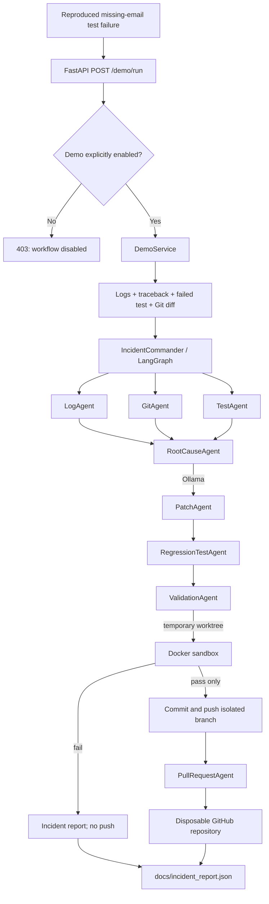

# SentinelOS disposable-repository workflow architecture



```mermaid
sequenceDiagram
    participant Demo
    participant Commander
    participant Agents as Incident agents
    participant Model as Local Ollama
    participant Validator as Docker / ValidationAgent
    participant Remote as Disposable GitHub

    Demo->>Demo: Reproduce missing email failure
    Demo->>Commander: Submit complete evidence bundle
    Commander->>Agents: Run log, git, test, and root-cause analysis
    Agents->>Model: Analyze cause, generate diff and tests
    Model-->>Agents: Structured proposals
    Agents-->>Demo: Incident report
    Demo->>Validator: Apply proposal in temporary worktree and test
    alt Passed
        Validator-->>Demo: Validation passed
        Demo->>Remote: Push branch and create PR
        Remote-->>Demo: PR URL
    else Failed
        Validator-->>Demo: Validation failure; leave base checkout unchanged
    end
```

`SENTINELOS_DEMO_REPOSITORY` selects the dedicated GitHub target. The workflow does
not create repositories; set the target up from `demo-repo/` before the run.
`docs/incident_report.json` captures the latest run and reports blocked or
unavailable stages explicitly rather than claiming success.
